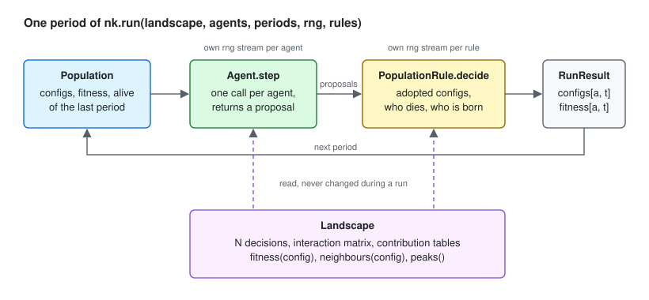
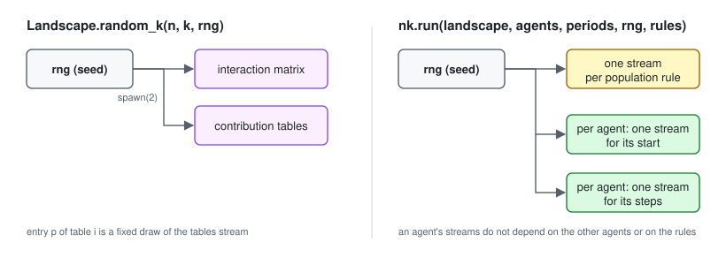

# nkscape

[](https://github.com/alexschnabl/nkscape/actions/workflows/ci.yml)
[](https://pypi.org/project/nkscape/)
[](https://pypi.org/project/nkscape/)
[](LICENSE)

Kauffman NK fitness landscapes and NK-based agent-based models of organizations in Python, in the
tradition of Levinthal (1997), Rivkin & Siggelkow (2003), Ethiraj & Levinthal (2004) and Wall
(2016, 2023).

```python
import nkscape as nk

landscape = nk.Landscape.next_k(10, 3, rng=42)  # N = 10 decisions, K = 3
print(landscape.count_peaks())  # 14

agents = [nk.agents.HillClimber("first") for _ in range(100)]
result = nk.run(landscape, agents, periods=20, rng=1)
print(result.fitness[:, -1].mean() / landscape.global_max())  # 0.944
```

## Installation

```bash
pip install nkscape
```

Requires Python 3.12 or newer. The only dependency is NumPy.

## Structure

A model consists of three objects.

| Object | Role |
|---|---|
| `nk.Landscape` | N binary decisions, an interaction matrix (which decisions affect which fitness contributions) and the random contribution tables. Fitness of a configuration is the average contribution. |
| `nk.Agent` | The search rule of one organization. Subclass it and write `step(config, landscape, rng, population)`, which returns the configuration the agent wants next. |
| `nk.PopulationRule` | A rule applied to the whole population once per period: selection, a central choice among proposals, births and deaths. Subclass it and write `decide(population, proposals, landscape, rng)`. |

One period of `nk.run`:

<p align="center">
  
</p>

`nk.run(landscape, agents, periods, rng, rules=[...])` runs the periods. In each period it calls
every agent's `step`, passes the proposals to the rules, records the adopted configurations and
their fitness, and returns a `nk.RunResult` with `configs[agent, period]`, `fitness[agent, period]`
and `alive[agent, period]`.

An agent in full:

```python
class OneRandomTry(nk.Agent):
    def step(self, config, landscape, rng, population):
        candidate = config.copy()
        candidate[rng.integers(landscape.n)] ^= 1
        return candidate if landscape.fitness(candidate) > landscape.fitness(config) else config
```

`population` is a read-only snapshot of every agent's configuration and fitness at the end of the
previous period, and of which agents exist. A rule returns the configurations the agents adopt; it
may return a `nk.PopulationDecision` instead to also name the agents that die and the agents that
are born. The number of agents may therefore change during a run.

`nk.agents.HillClimber(pick, long_jumps=False)` is the one ready-made agent. `pick` is `"first"`
(the first better neighbour, decisions tried in order), `"random"` (any better neighbour) or
`"best"` (the fittest neighbour). With `long_jumps=True` it also draws one random configuration per
period and takes it if it is better. `pick="first"` with long jumps is the search of Levinthal
(1997).

## Random numbers

There is no global random state. Every function that draws random numbers takes an `rng`
argument, a seed or a `numpy.random.Generator`, and the argument is required. From one seed,
every random ingredient gets its own stream:

<p align="center">
  
</p>

- The same seed gives the same landscape and the same run on every machine. Exact values for
  fixed seeds are pinned in `tests/test_reproducibility.py`.
- An agent walks the same way alone as in a population of any size, and adding rules or passing
  starting configurations does not change its draws.

```python
alone = nk.run(landscape, [OneRandomTry()], periods=20, rng=7)
crowd = nk.run(landscape, [OneRandomTry() for _ in range(50)], periods=20, rng=7)
assert (alone.configs[0] == crowd.configs[0]).all()
```

## Whole-landscape functions

For N up to 24 (`nk.set_enumeration_limit` changes the limit), `landscape.fitness_cube()` holds the
fitness of all 2^N configurations as an array with N axes of length 2, built by broadcasting the
contribution tables. `peaks()`, `count_peaks()` and `global_max()` read from it. `nk.run` builds
the cube when a run is long enough to repay the cost; `build_cube=True/False` overrides this.
Values read from the cube are identical to values looked up directly, bit for bit. `dtype=np.float32`
on the landscape builders halves the memory.

## Replications

Published results reproduced with nkscape:

- Levinthal (1997), *Adaptation on Rugged Landscapes*, Figures 1 to 9:
  [`examples/levinthal_1997`](examples/levinthal_1997/levinthal_1997.ipynb)

## Status

Version 0.1: landscapes, agents, population rules, births and deaths, and the Levinthal (1997)
replication. [CHANGELOG.md](CHANGELOG.md) lists what exists.

## Ideas for the future

What I would like to add as time allows, roughly in this order:

- Departments: agents that own subsets of the decisions of one shared configuration and are
  judged by their own contributions; coordination modes (decentralized, central) and incentive
  schemes, after Rivkin & Siggelkow (2003) and Wall (2016).
- Satisficing agents: aspiration levels adapted from performance feedback, search that stops at
  the first option that is good enough (Wall 2023).
- Experiment runner: run definitions in files, seed grids, parallel runs, results as Parquet.
- Plots: interaction matrix, performance over time, department views.
- Contributions computed on demand instead of stored, for N and K beyond what fits in memory,
  on CPU or GPU. The library never reads the stored tables directly; it asks the tables object
  for contribution *i* of a configuration, so a computing backend can replace the storing one
  without other changes. Such a backend would be seeded on its own scheme and need not reproduce
  the stored tables.
- Learning agents: departments as reinforcement-learning agents, to see whether learned behaviour
  changes the results obtained with hand-written search rules.

## Development

```bash
uv sync --group notebooks
uv run pytest
uv run ruff check . && uv run ruff format --check . && uv run mypy
uv run pytest --nbmake --overwrite examples/   # re-run the replication notebooks
```

## References

- Levinthal, D. A. (1997). Adaptation on rugged landscapes. *Management Science*, 43(7), 934–950.
- Rivkin, J. W., & Siggelkow, N. (2003). Balancing search and stability: Interdependencies among
  elements of organizational design. *Management Science*, 49(3), 290–311.
- Ethiraj, S. K., & Levinthal, D. (2004). Modularity and innovation in complex systems.
  *Management Science*, 50(2), 159–173.
- Wall, F. (2016). Agent-based modeling in managerial science: An illustrative survey and study.
  *Review of Managerial Science*, 10(1), 135–193.
- Kauffman, S. A. (1993). *The Origins of Order*. Oxford University Press.

## License

MIT, see [LICENSE](LICENSE).
